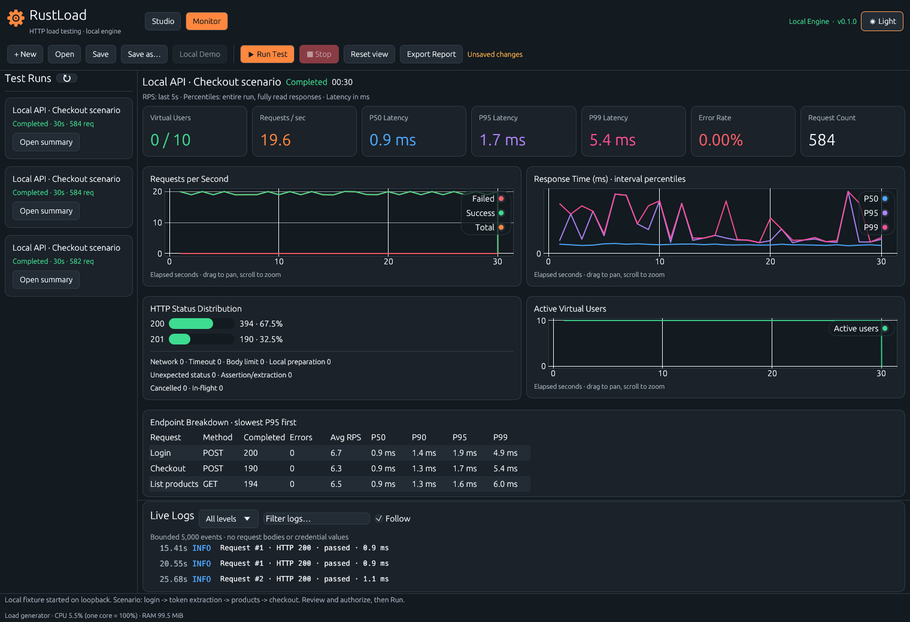
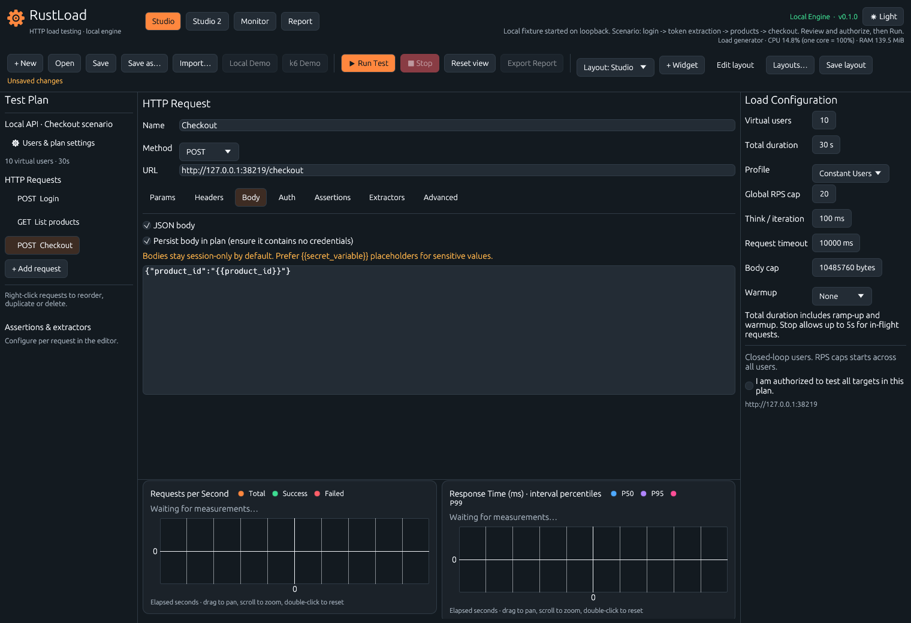
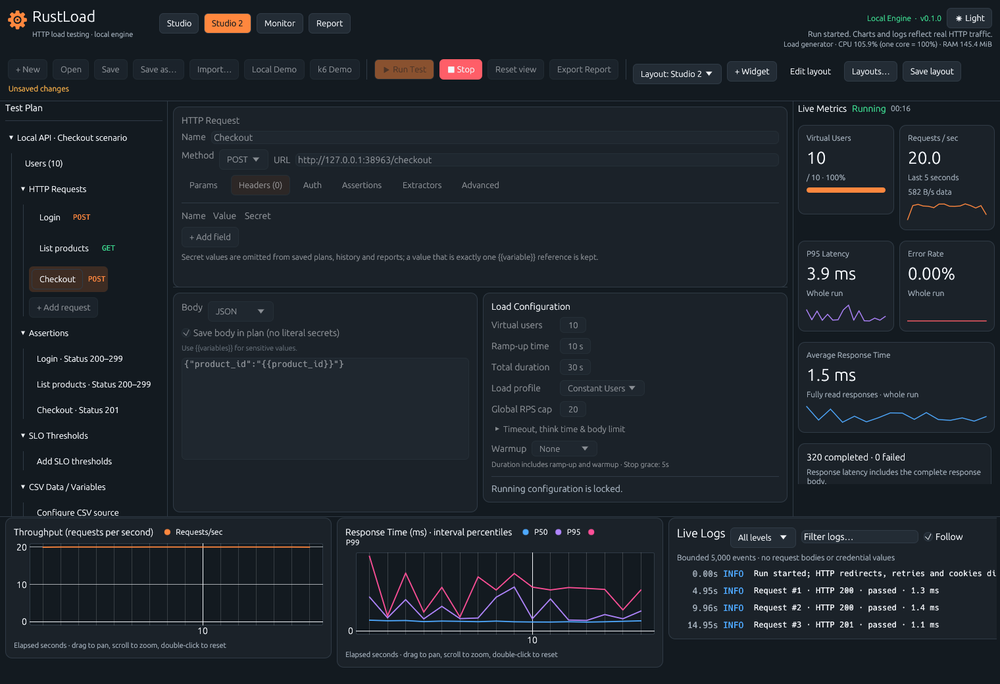
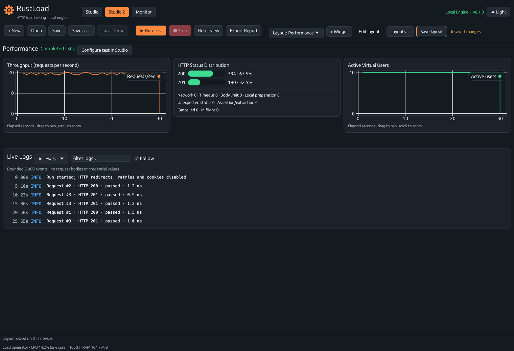
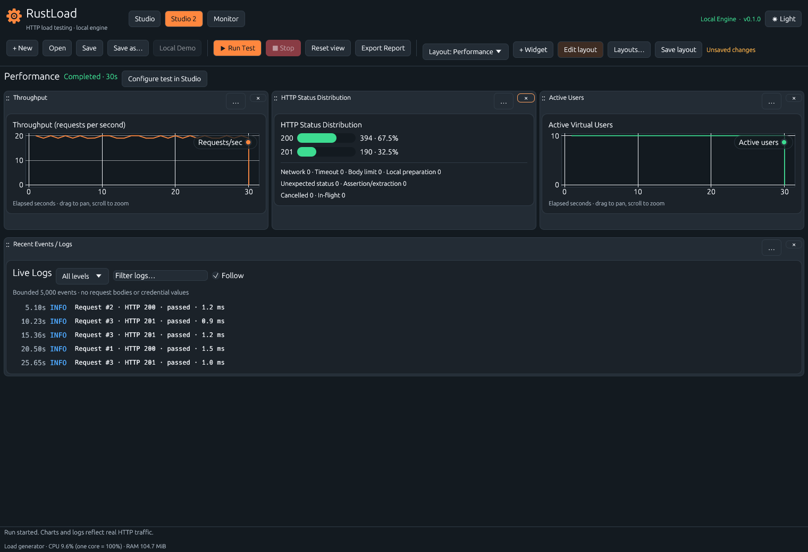

# RustLoad

[English](README.md) · [Türkçe](README_tr.md)

RustLoad, HTTP API'lerini yük altında test etmek için geliştirilmiş bir masaüstü
uygulaması. Ardışık isteklerden bir senaryo oluşturabilir, eşzamanlı sanal
kullanıcılarla çalıştırabilir ve test sürerken yanıt sürelerini, istek hızını
ve hataları izleyebilirsiniz.

Uygulama Rust ve egui/eframe ile yazıldı. Yük motoru kendi bilgisayarınızda
çalışır; geçmişi SQLite'ta saklar, raporları çevrimdışı açabilirsiniz. Hesap,
ayrı bir backend servisi veya Docker gerekmez.

[Başlangıç](#başlangıç) · [Çalışma alanları](#çalışma-alanları) ·
[Kişisel dashboardlar](#kişisel-dashboardlar) · [Ölçümler](#sonuçlar-nasıl-ölçülür) ·
[Geliştirme](#geliştirme)

<picture>
  <source media="(prefers-color-scheme: light)" srcset="docs/screenshots/monitor-light.png">
  
</picture>

*Yerel demo tamamlandıktan sonra Monitor ekranı. Bu sayfadaki ekran görüntüleri,
uygulamayla gelen HTTP test sunucusu kullanılarak Linux üzerinde alındı.*

## Neler yapabilirsiniz?

| İşlem | RustLoad'da karşılığı |
| --- | --- |
| HTTP senaryosu oluşturma | Ardışık GET, POST, PUT, PATCH ve DELETE istekleri; header, sorgu parametresi, ham veya JSON gövde, Basic ve Bearer kimlik doğrulaması |
| İstekler arasında veri aktarma | Değişkenler, kullanıcıya atanmış CSV satırları ve erişim token'ı gibi değerler için JSON Pointer ile veri çıkarma |
| Yanıtları doğrulama | Beklenen durum kodu, yanıt süresi sınırı ve JSON Pointer eşitlik kontrolleri |
| Yükü yapılandırma | Eşzamanlı kullanıcı sayısı, sabit veya doğrusal artış profili, toplam süre, senaryo tekrarları arasındaki bekleme, zaman aşımı ve ortak istek başlatma sınırı |
| Testi izleme | İstek hızı, gecikme yüzdelikleri, aktif kullanıcılar, HTTP durum kodları, uç nokta özetleri ve filtrelenebilir loglar |
| Çalışma alanını düzenleme | İki Studio düzeni; Studio, Studio 2 ve Monitor'da özelleştirilebilir widgetlar ve adlandırılabilir sayfalar, sürükleyerek sıralama, ayarlanabilir genişlikler, koyu ve açık tema |
| Sonuçları saklama | Yerel SQLite geçmişi ve HTML, JSON veya CSV olarak dışa aktarma |

RustLoad şu anda MVP aşamasında. Linux üzerinde çalışması kontrol edildi.
Hedef platform olan macOS'ta yerel kabul testleri henüz yapılmadı. Bir sürüm
hazırlamadan önce [platform durumuna](#platform-durumu) bakın.

## Başlangıç

### Hazır paketi indirme

Bir sürüm yayımlandığında [GitHub Releases](https://github.com/hakanngul/RustLoadTesting/releases)
sayfasında Apple Silicon ve Intel için macOS DMG'leri, Windows x64 ZIP'i, Linux
x64 arşivi ve SHA-256 doğrulama dosyası bulunur. Kurulum gereksinimleri, imzalama
durumu ve yayımlama adımları [release rehberinde](docs/releases.md) anlatılıyor.

### Kaynak koddan çalıştırma

Rust'ı [rustup](https://rustup.rs) ile kurun, ardından depoyu klonlayın:

```sh
git clone https://github.com/hakanngul/RustLoadTesting.git
cd RustLoadTesting
```

Masaüstü uygulamasını başlatın:

```sh
cargo run --locked
```

`rust-toolchain.toml`, Rust 1.99.1 sürümünü seçer. İlk derlemede bu araç zinciri
ve sürümleri `Cargo.lock` içinde sabitlenmiş bağımlılıklar indirilir.

Uygulamayı açmak için bir grafik oturumu ve OpenGL gerekir. Linux'ta
X11/Wayland, xkbcommon ve GL çalışma zamanı kütüphaneleri de kurulu olmalı.
macOS'ta bağlayıcı için Xcode Command Line Tools'u (`xcode-select --install`)
kurun.

### Yerel demoyu deneyin

Demo, harici bir servise trafik göndermeden çalışan bir senaryoyu denemenizi
sağlar. Arayüzdeki düğme ve seçenek adları İngilizcedir.

1. RustLoad'u açın. Planda kaydedilmemiş değişiklik yokken **Local Demo**
   düğmesine tıklayın. Uygulama geçici bir `127.0.0.1` portunda test sunucusu açar.
2. Login, List products ve Checkout isteklerini inceleyin. Login yanıtından
   `/access_token` çıkarılır; ürün isteği `{{access_token}}` değerini, checkout
   ise `product_id` değişkenini kullanır.
3. Studio'nun yük yapılandırma panelindeki **I am authorized to test all targets
   in this plan.** kutusunu işaretleyin ve **Run Test** düğmesine tıklayın.
4. Sonuçları Monitor'dan takip edin. Demo 10 sanal kullanıcıyla 30 saniye çalışır;
   saniyede en fazla 20 HTTP isteği başlatır.
5. Testin bitmesini bekleyin veya **Stop** ile durdurup o ana kadarki sonuçları
   saklayın. **Export Report** ile HTML, JSON veya CSV kaydedebilir, geçmiş
   panelinden önceki bir çalıştırmanın özetini yeniden açabilirsiniz.

Kaydedilen demo planı geçici sunucu portunu da içerir. Uygulamayı yeniden
başlattığınızda bu port değişir. Sabit portlu bir sunucu için başka bir
terminalde şu komutu çalıştırın:

```sh
cargo run --locked --example fixture
```

Test sunucusu Ctrl-C ile kapatılana kadar `127.0.0.1:8080` adresinde dinler.
Plandaki istek URL'lerini bu adrese göre değiştirin. Kendi testlerinizde yalnızca
test etme izniniz olan hedefleri kullanın.

## Çalışma alanları

### Studio

Studio, ana senaryo editörüdür. Soldaki listeden bir istek seçin, ortadaki
alandan parametrelerini düzenleyin ve sağdan kullanıcı sayısı ile süreleri
ayarlayın. Bir isteğe sağ tıklayarak sırasını değiştirebilir, çoğaltabilir veya
silebilirsiniz.



İki Studio düzeni aynı test planını ve seçili isteği paylaşır. Test başladığında
yapılandırma, çalışma bitene kadar kilitlenir. Studio'dan başlatılan test Monitor'ı
açar; Studio 2'den başlatıldığında çalışma alanı açık kalır.

### Studio 2

Studio 2, istek ağacını, HTTP editörünü, gövdeyi ve yük yapılandırmasını birlikte
gösterir. Canlı metrikler sağda, grafikler ve loglar alttadır. Düzenleme için daha
fazla alan gerektiğinde bu widgetları gizleyebilir veya taşıyabilirsiniz.



Dar pencerelerde paneller daraltılabilir hale gelir veya sekmelere dönüşür.
Ayrıntılar için [Studio 2 rehberine](docs/studio2.md) ve
[küçük pencere görüntüsüne](docs/screenshots/studio2-compact.png) bakabilirsiniz.

### Monitor

Monitor, mevcut testin istek hızını, yanıt verisi hızını, P50/P95/P99
gecikmelerini, hata oranını ve istek sayısını gösterir. Grafiklerden istek hızını, ölçüm aralıklarına ait
gecikmeleri ve aktif kullanıcı sayısını izleyebilirsiniz. HTTP durum kodları,
uç nokta sonuçları ve filtrelenebilir loglar hataları incelemenize yardımcı olur.
Planda SLO eşiği varsa sonuçları çalıştırma başlığının altında görünür.
Kaydedilmiş bir özeti açmak için soldaki geçmişten bir çalıştırma seçin.
Çalıştırma başlığının altındaki her şey düzenlenebilir bir widget sayfasıdır
(bkz. [Kişisel dashboardlar](#kişisel-dashboardlar)); widgetlar açık olan
çalıştırmayı gösterir.

Load Configuration altında warmup ayarlandıysa (**By duration** veya **By
requests**), Monitor önce warmup ilerlemesini, ardından kaç isteğin hariç
tutulduğunu ve ölçümün ne zaman başladığını gösterir. RPS grafiği warmup
trafiğini ayrı gri bir çizgiyle çizer ve warmup'ın bittiği anı işaretler.

Kaydedilmiş iki çalıştırmayı karşılaştırmak için kenar çubuğunda birini
**Baseline** ile sabitleyin, ardından diğerinde **Compare** seçin. Karşılaştırma
iki çalıştırmanın throughput ve P95 grafiklerini üst üste çizer, tüm çalıştırma
için metrik başına değişimi ve istek ID'siyle eşleşen istek bazındaki
değişimleri gösterir. Her metrik Improved, Regressed veya Unchanged olarak
işaretlenir; genel sonuç Improved, Regressed, Mixed veya Unchanged olur. Gürültü
bandı içindeki değişimler (varsayılan ±%2, ayarlanabilir ve hatırlanır)
değişmemiş sayılır; bu bir tolerans aralığıdır, istatistiksel anlamlılık testi
değildir. Kullanıcı sayısı, süre, yük profili, RPS sınırı, think time, timeout
veya istek adımları farklı olan çalıştırmalar yine karşılaştırılır, ancak uyarı
gösterilir. **Swap** baseline ile adayın yerini değiştirir.

Uygulamanın tamamında koyu ve açık tema kullanılabilir. Açık temadaki
[Studio](docs/screenshots/studio-light.png),
[Studio 2](docs/screenshots/studio2-light.png) ve
[Monitor](docs/screenshots/monitor-light.png) görüntülerini de inceleyebilirsiniz.

## Kişisel dashboardlar

Studio, Studio 2 ve Monitor'un her birinin kendi widget sayfaları vardır; bir
çalışma alanını düzenlemek diğerlerini değiştirmez. Varsayılan sayfalar her
alanın yerleşik düzenini aynen verir. Studio 2'de istekleri düzenlerken yalnızca
istek hızı grafiğini açık bırakabilir veya sonuçlar için ayrı bir sayfa
oluşturabilirsiniz; Monitor'da örneğin gecikme dağılımını diğer sonuç
grafiklerinin yanına ekleyebilirsiniz.



Mevcut sayfayı düzenlemek için:

1. Sürükleme tutamaçlarını ve widget kontrollerini açmak için **Edit layout**
   düğmesine tıklayın.
2. **+ Widget** ile grafik, tablo, log paneli veya canlı metrik grubu ekleyin.
3. Widgetları sürükleyerek sıralayın. Menülerinden satır genişliğini ayarlayabilir,
   öne/arkaya alabilir veya paneller arasında taşıyabilirsiniz: Studio 2'de
   Bottom ve Right; Monitor'da Main area, Bottom ve Right. Studio, Load
   Configuration'ı sağda tuttuğu için widgetlarını yalnızca altta gösterir.
4. Bir widgetı gizlemek için **×** düğmesine tıklayın. **Layouts…** üzerinden
   yeniden gösterebilirsiniz. Boş kalan paneller kapanır, alan editörlere kalır.
5. Düzeni bu cihazda saklamak için **Save layout** düğmesine tıklayın.

Ayrı bir sayfa oluşturmak için **Layouts…** menüsünden **Create blank page**
veya **Duplicate current page** seçeneğini kullanın. Studio 2'de yeni boş
sayfalar istek editörünü gizleyen dashboard modunda açılır; Studio ve Monitor
sabit editörlerini ve çalıştırma başlığını korur. Sayfaları yeniden
adlandırabilir ve test sürerken aralarında geçiş yapabilirsiniz.

<details>
<summary>Widget düzenleme kontrollerini göster</summary>



</details>

Katalogda her çalışma alanında kullanılabilen on widget var: istek hızı, saniye
başına istek (toplam/başarılı/başarısız), gecikme, loglar, aktif kullanıcılar,
HTTP durum dağılımı, uç nokta özeti, canlı metrikler, KPI kartları (Monitor'un
sekiz temel değeri) ve gecikme dağılımı. Studio ve Studio 2'de mevcut
çalıştırmayı, Monitor'da mevcut veya açılan geçmiş çalıştırmayı gösterirler. Gecikme dağılımı, tüm çalıştırmanın histogramını
(yalnızca ölçüm penceresi) en hızlı ve en yavaş yanıt arasında en fazla 40
logaritmik aralıklı çubukla çizer; aynı histogramın P50/P95/P99 değerlerini
işaretler. Çubuğun üzerine gelince aralığı ve yanıt sayısı görünür. Aynı widgettan birden fazla ekleyebilirsiniz. Bu sürümde log
filtreleri ve otomatik takip ayarı, log widgetları arasında ortaktır.

Her çalışma alanında en fazla 20 düzen, her düzende 16 widget bulunabilir. Sayfa adları benzersiz ve
1 ile 60 karakter arasında olmalı. Düzenler test planlarından ayrı kaydedilir;
planı JSON olarak kaydetmek dashboard'u dışa aktarmaz.
[Widget rehberinde](docs/widgets.md) boyutlandırma, varsayılanları geri yükleme
ve kayıt davranışı anlatılıyor. Harici veri kaynakları, özel sorgular, eklentiler
ve piksel bazında serbest yerleşim henüz uygulanmadı.

## Senaryolarla çalışma

URL yolunda ve sorgu değerlerinde, header alanlarında, istek gövdesinde veya
kimlik doğrulamada `{{variable}}` kullanabilirsiniz. URL'nin şeması ve sunucu
adı sabit olmalı. Eksik bir değişken, ilgili adımın istek hazırlama hatasıyla
başarısız olmasına yol açar. Herhangi bir adım başarısız olursa o senaryo
tekrarındaki kalan istekler atlanır.

Yanıttan değer çıkarmak için `/access_token` veya `/items/0/id` gibi RFC 6901
JSON Pointer ifadeleri kullanılır. Burada JSON Pointer geçerlidir, JSONPath
desteklenmez. Doğrulamalarla beklenen durum kodunu, yanıt süresi üst sınırını
ve bir JSON Pointer değerinin eşitliğini kontrol edebilirsiniz.

CSV sütun adları, her sanal kullanıcıya özel değişkenlere dönüşür. Kullanıcı
test boyunca aynı satırı kullanır. Satırların yeniden kullanılması ayrıca
etkinleştirilir; aynı sütun adı birden fazla kez bulunamaz. Göreli CSV yolları,
kaydedilmiş planın bulunduğu dizine göre çözülür. Plan henüz kaydedilmediyse
uygulama işleminin çalışma dizini esas alınır.

### cURL, HAR veya OpenAPI'den içe aktarma

Araç çubuğundaki **Import…**, istekleri tarayıcınızdan oluşturur. DevTools'ta
*Copy as cURL (bash)* (veya *Copy all as cURL*) ile kopyaladığınız bir ya da
daha fazla komutu yapıştırın veya DevTools → Network → *Save all as HAR* ile
kaydettiğiniz HAR dosyasının yolunu verin. İstekleri ve uyarıları önizleyip
plana ekleyebilir ya da mevcut isteklerin yerine koyabilirsiniz.

- URL'deki sorgu parametreleri Params'a taşınır; URL içindeki kimlik bilgileri
  Basic Auth'a dönüşür.
- `-H`, `-X`, `-d`/`--data-raw`/`--data-binary`/`--data-urlencode`, `--json`,
  `-u`, `-G`, `-b`, `-A`, `-e` ve `--url` desteklenir. JSON içerik türüne sahip
  JSON gövdeler JSON gövde olarak alınır.
- Bağlantı header'ları, `Content-Length` ve `Accept-Encoding` kaldırılır:
  yanıtlar sıkıştırılmadan okunur, böylece boyutlar ve extraction doğru kalır.
- `-k`, `-L`, `-F`, `-T`, `@dosya` verileri ve HEAD/OPTIONS istekleri alınmaz;
  önizleme neyin neden atlandığını listeler.
- HAR içe aktarma yalnızca XHR/fetch isteklerini tutabilir. Sadece istekler
  okunur, HAR'daki yanıtlar hiçbir zaman içe aktarılmaz. En fazla 50 MiB dosya
  ve 500 istek.
- Authorization, Cookie ve diğer kimlik bilgisi değerleri secret olarak
  işaretlenir: mevcut oturumda çalışır ama diğer secret'lar gibi asla kaydedilmez.
  Değeri tam olarak tek bir `{{değişken}}` referansı olan secret, bu referans
  olarak kaydedilir.
- **OpenAPI (JSON/YAML)**, OpenAPI 3.x veya Swagger 2.0 JSON ya da YAML
  dosyasının (`.json`, `.yaml`, `.yml`) yolunu alır. Biçim içerikten anlaşılır:
  `{` veya `[` ile başlayan dosya JSON, diğerleri YAML olarak okunur.
  **Preview**, her GET/POST/PUT/PATCH/DELETE işlemini belgedeki sırasıyla
  (path'ler yazıldığı sırada, bir path içindeki metotlar da yazıldığı sırada)
  metot, path, ad ve etiketleriyle listeler. Liste metinle (path, ad
  veya operationId), metotla veya etiketle filtrelenebilir; **Select all** ve
  **None** yalnızca filtrenin gösterdiği işlemlere uygulanır. Başlangıçta tüm
  işlemler seçilidir ve yalnızca işaretli olanlar içe aktarılır. Pencere seçili
  işlem sayısını gösterir; seçim planı 500 isteğin üzerine çıkaracaksa Import
  devre dışı kalır.
- Belgenin yanındaki başka JSON veya YAML dosyalarına giden `$ref`'ler
  izlenir; örneğin `common.json#/components/schemas/Pet` veya
  `./schemas/pet.yaml`. Yol,
  referansı içeren dosyaya göre çözülür. Yalnızca belgenin klasöründeki (ve alt
  klasörlerindeki) dosyalar okunur: dışarı çıkan `..`, mutlak yollar ve dışarıyı
  gösteren sembolik bağlantılar reddedilir. Hiçbir şey indirilmez: `http(s)`
  referansları listelenir ve çözümlenmeden bırakılır. Dosya başına en fazla
  10 MiB ve toplam en fazla 50 dosya okunur; her dosya bir kez okunur, böylece
  birbirine referans veren dosyalar döngüye girmez. Çözümlenemeyen referanslar
  önizlemede adıyla (dosya içeriği olmadan) listelenir; önizleme kaç dosyanın
  okunduğunu da gösterir.
- Belgede birden fazla server ya da `enum` içeren server değişkenleri varsa
  önizleme server ve bu değişkenlerin her biri için bir açılır liste sunar;
  ilk server ve varsayılan değerler seçili gelir. Birden fazla `schemes`
  değeri olan Swagger 2.0 belgesi şema (http/https) seçimi sunar. Seçimi
  değiştirmek dosyaları yeniden okumadan istek URL'lerini günceller; önizleme
  isteklerin nereye gideceğini gösterir. **Base URL** alanına bir adres
  girerseniz seçimin yerine o kullanılır, böylece spesifikasyonu başka bir
  yerel veya staging hedefe yöneltebilirsiniz. Her durumda URL kimlik bilgisi
  ve query içermeyen, host'u olan mutlak bir http(s) adresi olmalıdır. Path
  parametreleri, örnek değerleriyle plana eklenen
  `{{değişkenler}}` olur; zorunlu query/header parametreleri `example`,
  `examples`, `default` veya `enum` değerlerini kullanır.
- JSON gövdeler belgedeki değerleri (`example`, `examples`, `default`, `enum`,
  alanların içindekiler dahil) kullanır. `allOf` üyeleri birleştirilir;
  `oneOf`/`anyOf` için ilk seçenek alınır. Belgede değer yoksa türe göre yer
  tutucu yazılır: zorunlu alanlar (hiçbiri zorunlu değilse tüm alanlar),
  metinler için `""` (date-time, date, uuid ve email biçimleri için
  `1970-01-01T00:00:00Z`, `1970-01-01`, sıfır UUID veya `user@example.com`),
  sayılar için `0` ya da `minimum`, `false` ve tek öğeli diziler. Kendini
  tekrarlayan şemalar ilk tekrarda durur. Bunlar test verisi değil yer
  tutucudur: önizleme, şema türlerinden oluşturulan gövdeleri sayar ki gözden
  geçirebilesiniz.
- Bearer ve OAuth güvenliği `{{access_token}}` olur; header veya query'deki API
  anahtarları o header/parametreye `{{api_key}}` (sonraki şemalar için
  `{{api_key_2}}`…) değeriyle eklenir. Bunlar çalıştırmadan önce doldurduğunuz
  secret plan değişkenleridir; kaydedilen plan değerleri değil yalnızca
  referansları tutar. Basic Auth kimlik bilgisi ister. Cookie'deki API
  anahtarları, diğer şemalar, cookie parametreleri ve JSON olmayan gövdeler
  önizlemede listelenir.
- YAML, YAML 1.2 core şemasıyla okunur: `yes`/`no`/`on`/`off` metin kalır;
  tırnaksız sayılar ve `true`/`false`/`null` türlenir; tırnaklı değerler
  metindir. Anahtarlar yazıldıkları sırayı ve metni korur (`200:` yanıt kodu
  `"200"` olur). Anchor, alias ve `<<` birleştirme anahtarları çalışır; core
  dışındaki etiketler (`!!str`, `!!int`… dışındakiler) yok sayılır. JSON'da
  karşılığı olmadığı için `.inf`/`.nan` metin kalır. Dosya başına tek belge;
  128 seviyeden derin iç içe yapı ve 64 MiB'ı aşacak alias açılımı reddedilir.
  Hatalar satır ve sütunla kısa bir neden gösterir, dosya içeriğini göstermez.

### SLO eşikleri

Başarılı/başarısız hedeflerini Studio'da **Users & plan settings**, Studio 2'de
**SLO Thresholds** ağacından ekleyebilirsiniz; örneğin `P95 latency ≤ 300 ms`
veya `Error rate ≤ 1 %`. Bir eşik tüm çalıştırmaya ya da tek bir isteğe
uygulanır. P50/P90/P95/P99/ortalama gecikme ve hata oranı üst sınırdır;
throughput alt sınırdır. Bir planda en fazla 50 eşik olabilir.

Eşikler çalıştırmayı hiçbir zaman durdurmaz. Test sürerken Monitor ve canlı
metrik panelleri her eşiğin o an karşılanıp karşılanmadığını gösterir. Test
bitince çalıştırma bir karar alır: **Passed**, **Failed** (herhangi bir eşik
aşıldıysa) veya **Inconclusive** (bir eşik için veri yoksa, örneğin hiç
tamamlanmamış bir istek). İptal edilen veya başarısız çalıştırmalar "partial"
olarak işaretlenir. Karar geçmişe kaydedilir ve HTML, JSON ve CSV raporlarına
eklenir.

Planlar şema sürümü 1'i kullanır. Bilinmeyen sürümler reddedilir. Açma ve
kaydetme işlemleri dosya yolu girilen bir pencereden yapılır. Cmd/Ctrl+S
kaydeder, Cmd/Ctrl+O açar, Cmd/Ctrl+Q güvenli kapatmayı başlatır. Kapanışta
kaydedilmemiş değişiklikler için uyarı verilir ve aktif çalışma durdurulur.

### Kimlik bilgileri ve kaydedilen veriler

Doğrudan girilen gizli kimlik bilgileri ve gizli işaretlenmiş alanlar planlara,
geçmişe veya raporlara yazılmaz. Değeri tam olarak tek bir değişken referansı
(`{{access_token}}`, `{{api_key}}` gibi) olan kimlik doğrulama alanları,
header'lar, query parametreleri ve değişkenlerde bu referans korunur; düz
değerler ve `Bearer {{token}}` gibi karışık metinler kaydedilmez. Planı yeniden
açtığınızda kaydedilmeyen gizli değerleri tekrar girmeniz gerekir.

Gövdeyi kaydetme seçeneğini açmadığınız sürece istek gövdeleri yalnızca oturumda
kalır. Kimlik bilgilerini kaydedilen gövdeye yazmak yerine gizli değişkenler
kullanın. Geçmişe alınan yapılandırma kopyaları, istek gövdelerini ve URL sorgu
dizelerini içermez. Yanıt gövdeleri loglara yazılmaz.

## Sonuçlar nasıl ölçülür?

RustLoad kapalı döngü modeliyle çalışır: her sanal kullanıcı senaryoyu sırayla
tamamlar, ardından bir sonraki tekrar için ayarlanan süreyi bekler. Toplam test
süresine kullanıcıların kademeli artış süresi de dahildir.

**Arrival Rate (open)** profili açık modeldir: senaryo tekrarları, hedefin ne
kadar hızlı yanıt verdiğinden bağımsız olarak sabit bir hızda (tekrar/saniye)
başlar; yavaşlayan bir hedef uygulanan yükü düşürmez. Her tekrar en fazla
**Max VUs** kadar sanal kullanıcıdan oluşan havuzdaki boş bir kullanıcıda
çalışır. Tüm kullanıcılar meşgulse tekrar başlatılmaz ve **dropped iteration**
olarak sayılır; bunlar istek olmadığından hata oranına girmez. Bu modda ortak RPS
sınırı ve senaryo arası bekleme uygulanmaz.

**Ramp the rate** işaretlenirse hız en fazla 20 hız aşamasıyla zamanla değişir
(örneğin 60 s'de 0'dan 100 it/s'ye, 240 s boyunca 100 it/s, 60 s'de 100'den 0'a).
Hız alanı **Start rate** (başlangıç hızı) olur; her aşama bir önceki hızdan
hedefine doğrusal geçer ve toplam süre aşamaların toplamıdır. `k`. tekrar, hızın
zamana göre integrali `k`'ye ulaştığında başlar; bu yüzden hızı 0 olan bir aşama
yeni başlangıçları durdurur. Tablo ve sürüklenebilir önizleme kullanıcı
aşamalarıyla aynıdır. Throughput grafikleri planlanan hızı kesikli **Target it/s**
çizgisiyle gösterir; bir tekrar birden fazla istek gönderebildiği için istek/s
bunun katı olabilir. Hız aşaması yoksa hız, eski planlarda olduğu gibi sabittir.

**Stages** profili kullanıcı sayısını en fazla 20 aşamayla şekillendirir; her
aşama bir önceki sayıdan (başlangıçta 0) hedefe doğrusal geçer. Aşamaları
tablodan düzenleyebilir veya önizleme grafiğindeki noktaları sürükleyebilirsiniz.
Sayı düştüğünde kullanıcılar mevcut tekrarlarını bitirip durur.

| Ölçüm | Anlamı |
| --- | --- |
| Başarılı istek | Varsayılan olarak HTTP 200 ile 299 arası veya ayrıca belirlenen beklenen durum kodu; tüm doğrulama ve veri çıkarma işlemlerinin de başarılı olması gerekir |
| Tamamlanan istekler | Başarılı ve başarısız isteklerin toplamı; iptal edilen ve devam eden istekler ayrı sayılır |
| Hata oranı | Başarısız istek sayısının tamamlanan isteklere oranı; iptaller hesaba katılmaz |
| HTTP hata sayıları | Başarı koşulundan bağımsızdır: beklenen bir 401 başarılı sayılabilir ve HTTP durum kodu sayımında da görünür |
| Yanıt gecikmesi | HTTP isteğinin yürütülmeye başlamasından yanıt gövdesinin tamamen okunmasına kadar geçen süre; hız sınırlaması ve senaryo arası bekleme hariçtir, ağ hataları ve zaman aşımları yanıt histogramlarına girmez |
| Yüzdelik kartları | Tüm çalıştırmanın HDR Histogram sonuçları |
| Yüzdelik grafikleri | Her ölçüm aralığına ait bağımsız histogramlar; aralıkların yüzdelikleri ortalanmaz |
| RPS kartı | Son beş saniyedeki tamamlanmalardan hesaplanan saniyelik istek sayısı; pencere sınırındaki kovalar kapsanan süreye göre ağırlıklandırılır |
| Warmup | Opsiyonel; süreye veya istek sayısına göre. Warmup sırasında başlayan istekler hiçbir sonuç metriğine girmez ve ayrı sayılır; toplam süre warmup'ı içerir; tüm çalıştırma throughput'u warmup sonrasındaki süreyi kullanır |
| Çalıştırma karşılaştırması | Throughput ve veri, her çalıştırmanın tamamında tamamlanan istek ve byte'ların geçen süreye bölümüdür; gecikme tüm çalıştırmanın histogramını kullanır; veri hızı bilgi amaçlıdır ve sonucu etkilemez |
| SLO kararı | Gecikme eşikleri tüm çalıştırmanın histogramını, hata oranı tamamlanan istekleri kullanır; throughput, beş saniyelik RPS kartı değil, tamamlanan isteklerin tüm süreye bölümüdür. Ölçülen değer hedefe eşitse eşik karşılanmış sayılır |
| Hata nedenleri | Ölçülen her başarısız istek, istek bazında ilk nedeniyle bir kez sayılır: aktarım (zaman aşımı, bağlantı reddi, sıfırlanan/kapanan bağlantı, yanıt öncesi hata, gövde okuma, gövde sınırı, geçersiz şablon), beklenmeyen durum kodu, gecikme sınırı, JSON doğrulaması veya veri çıkarma. Nedenler yalnızca durum kodu, plan değerleri ve sabit etiketlerden oluşur; URL içerebilen yanıt içeriği veya aktarım hata metni asla kullanılmaz. En fazla 100 grup; durum panelinde ve HTML/JSON raporlarında görünür |
| Data / sec kartı | Aynı pencerede saniyedeki yanıt gövdesi byte'ı; yalnızca tamamen okunan yanıtlar sayılır, header'lar dahil değildir |
| Düşürülen tekrarlar | Yalnızca Arrival Rate: tüm Max VUs meşgul olduğu için başlatılamayan planlı tekrarlar. Durum panelinde ve HTML raporunda görünür; karşılaştırma, tekrar düşüren çalıştırmalar için uyarı verir |
| Ortak RPS sınırı | Yalnızca kapalı model profilleri. Tüm kullanıcıların HTTP istek başlangıçlarını zamanlar; zamanlayıcı gecikmesinin en fazla 10 ms'lik kısmı telafi edilir, boşta geçen süre toplu istek başlatma hakkı biriktirmez |

P50/P90/P95/P99 için HDR histogramları kullanılır. Değerler mikrosaniye olarak
kaydedilir, milisaniye olarak gösterilir. Örnek bulunmayan ölçümlerde yer tutucu
görünür. **Stop**, yeni istekleri engeller ve hız sınırlaması ile senaryo arası
beklemeleri keser. Devam eden isteklere tamamlanmaları için en fazla beş saniye
tanınır, ardından kalanlar iptal edilir. Son metrikler, sanal kullanıcı görevleri
sonlandıktan sonra kesinleşir.

Kullanıcının durdurduğu test **Cancelled**, süresi dolarak biten test **Completed**,
motorun iç hatasıyla sonlanan test **Failed** olarak işaretlenir. Süresi dolan
testlerde de devam eden istekler için aynı ek bekleme süresi uygulanır.

Sürüm 0.1'de otomatik yeniden deneme, yönlendirme takibi ve çerez yönetimi yoktur.
TLS doğrulaması açıktır. Uzak istekler sistemden devralınan HTTP proxy ayarlarını
kullanır; doğrudan yazılmış loopback adresleri için yerel istemci kullanılır.

Kapalı döngü testler, hedef aşırı yük altındayken gecikmeyi olduğundan düşük
gösterebilir (coordinated omission). Erişilen istek hızı, yük üreten bilgisayarın
CPU'suna, zamanlamasına, bağlantılarına ve hedefin davranışına da bağlıdır.
CPU ve RAM göstergeleri hedef sunucuyu değil, RustLoad işlemini ölçer. Local Demo
ve dayanıklılık testi, test sunucusunu aynı işlemde çalıştırdığı için bu ölçümler
sunucunun kaynak kullanımını da içerir.

## Saklama ve sınırlar

Çalıştırma geçmişi, işletim sisteminin RustLoad için ayırdığı yerel veri dizininde
`history.sqlite3` dosyasında tutulur. SQLite'a test sırasında toplu ölçümler,
test sonunda da sonuç özeti yazılır. Yazma başarısız olursa uygulama bunu bildirir;
mevcut sonuçları yine dışa aktarabilirsiniz. Arayüz tercihleri eframe'in platforma
özgü depolamasında saklanır.

| Öğe | Sınır |
| --- | --- |
| Canlı grafik geçmişi | 900 veri noktası |
| Loglar | 5.000 kayıt, mesaj başına en fazla 2 KiB |
| Yanıt gövdesi | Varsayılan 10 MiB, en fazla 100 MiB olarak ayarlanabilir; sınırı aşan yanıt hata sayılır |
| Plan veya CSV girdi dosyası | 16 MiB |
| Plandaki istekler | 500 tanım |
| Yapılandırma sınırları | En fazla 10.000 sanal kullanıcı ve saniyede 100.000 istek başlangıcı |

Yapılandırma sınırları, girilen değerleri doğrulamak içindir; ölçülmüş kapasite
sonuçları değildir. Kapasiteyi kendi donanımınızda ölçün. HTML raporları sonuçları
ve zaman serilerini içerir; metinlerdeki HTML özel karakterleri güvenli biçimde
kodlanır. Bu raporlarda etkileşimli bir dashboard bulunmaz.

## Geliştirme

Kontrolleri depo kök dizininde çalıştırın:

```sh
cargo fmt --all -- --check
cargo clippy --locked --all-targets -- -D warnings
cargo test --locked
cargo build --locked
```

Testler yerel HTTP sunucularını kullanır. Motoru 15 dakikalık bir dayanıklılık
testinden geçirmek için:

```sh
cargo run --locked --example soak -- 900 /tmp/rustload-soak
```

Dayanıklılık testi RSS, CPU ve sayaçları kaydeder; istek sayılarının tutarlılığını
denetler ve çevrimdışı bir JSON raporu yazar. Motoru ve yerel test sunucusunu
çalıştırır; arayüzün çizim katmanını kapsamaz. Kaydedilmiş komutlar ve sonuçlar
[doğrulama belgesinde](docs/validation.md) bulunuyor.

Motor, ayrı bir Tokio runtime kullanır ve arayüze toplu ölçüm kopyaları gönderir.
Depolama yazmaları ayrı bir iş parçacığında yürütülür. Yürütme veya
ölçüm davranışını değiştirmeden önce [mimariyi](docs/architecture.md) ve
[uygulama kararlarını](docs/decisions.md) inceleyin.

### Platform durumu

| Platform | Durum |
| --- | --- |
| Linux | Geliştirme ortamında derleme, otomatik testler ve yerel arayüz kontrolleri kayıtlı |
| macOS | Hedef platform; uygulamanın açılması, manuel kabul testleri ve paketleme henüz doğrulanmadı |
| Windows | Çalıştırma ve paketleme doğrulanmadı |

[Release workflow'u](.github/workflows/release.yml), sürüm etiketi gönderildiğinde
üç işletim sistemi için test, derleme ve paketleme yapar. Yalnızca dört hedefin
tamamı başarılı olduğunda yayımlar. Gerçek Actions sonuçlarını yerel doğrulama
kayıtlarından ayrı değerlendirin.

Mac üzerinde `bash scripts/package-macos.sh`, ad-hoc imzalı bir
`dist/RustLoad.app` oluşturur. Developer ID imzası, Apple notarization ve Windows
yayıncı sertifikası yapılandırılmadı. Platformların yerel arayüz kabul testleri
ayrı bir kontroldür; ayrıntılar [release rehberinde](docs/releases.md).

1.000 kullanıcıyla kapasite ve çizim katmanının uzun süreli bellek kullanımı
henüz ölçülmedi. Flow, Pause, şablonlar, tarayıcı emülasyonu, histogram
görselleştirmesi, çerez oturumları, dağıtık worker'lar ve performans testi
karşılaştırmaları mevcut uygulamanın kapsamı dışında.

## Belgeler

- [MVP kapsamı](docs/MVP.md)
- [Mimari](docs/architecture.md)
- [Uygulama kararları](docs/decisions.md)
- [Studio 2](docs/studio2.md)
- [Widgetlar ve kişisel düzenler](docs/widgets.md)
- [Test planı](docs/test-plan.md)
- [Doğrulama sonuçları ve kalan sürüm kontrolleri](docs/validation.md)
- [Release paketleri ve yayımlama](docs/releases.md)
- [İlk ürün gereksinimleri](docs/original-prd.md)
